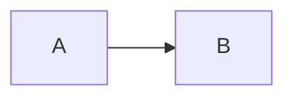

# 格式保存全项验收（2026-10-08）

## 一级标题：Markdown 格式全项验收

### 二级标题：基础文本样式测试

#### 三级标题：多语言与样式兼容

##### 四级标题：特殊文本格式

###### 五级标题：细节格式校验

####### 六级标题：收尾样式验证  
本次验收包含中文文本、English content、**粗体**、_斜体_、_**粗斜体**_、~~删除线~~、行内代码`func()`、`` `raw-inline` ``带反引号行内代码  
显式换行完成。

* * *

## 列表、引用与分隔线测试

-   无序列表项 A
-   无序列表项 B
-   无序列表项 C

3.  有序列表起始项
4.  有序列表第二项
5.  有序列表第三项

-   外层嵌套 1
    
    -   内层嵌套 1-1
    -   内层嵌套 1-2
    
-   外层嵌套 2
    
    -   内层嵌套 2-1
    
-   [x]  任务 1 已完成
    
-   [x]  任务 2 已完成
    
-   [ ]  任务 3 未完成
    
-   [ ]  任务 4 未完成
    

> 外层引用段落
> 
> > 内层嵌套引用段落

* * *

## 多语言独立代码块测试

```javascript
// 异步函数示例

async function fetchPrice() {
  const val = "$100";
  console.log(`price is ${val}`);
  return Promise.resolve(val);
}

fetchPrice();
```

```python
# 计算平方，中文注释
def square(x):

    return x * x

print(square(9))
```

```text
**bold**
## heading
$E=mc^2$
\反斜杠
```

## 四列对齐表格

| 左对齐 | 居中对齐 | 右对齐 | 左对齐 |
| :--- | :---: | ---: | :--- |
| 中文内容 | _斜体文字_ | 888 \| | 单行<br>单元格两行 |
| 公式项 | $x_i^2$ | 1024.75 | 数据记录 |

## LaTeX 数学公式测试

行内公式 5 个：行内分数$\frac{m+n}{3}$、上下标$a_2^{k}$、希腊字母$\theta,\sigma$、根号$\sqrt{t^2+1}$、求和$\sum_{j=1}^m j$

独立公式 7 个：  

$$
\frac{\frac{a}{b}+2}{c-4}
$$

  

$$
\int_{1}^{\infty} \frac{1}{x^2}dx = 1
$$

  

$$
B(p,q)=\frac{\Gamma(p)\Gamma(q)}{\Gamma(p+q)}
$$

  

$$
\binom{N}{k}=\frac{N!}{k!(N-k)!}
$$

  

$$
\begin{pmatrix}
0 & 1 \\
1 & 0
\end{pmatrix}
$$

  

$$
g(t)=
\begin{cases}
t & t>0 \\
0 & t\le0
\end{cases}
$$

  

$$
\begin{aligned}
3a-b &= 5\\
a+2b &= 4
\end{aligned}
$$

## 链接、图片与脚注

普通链接：[https://katex.org/docs/supported](https://katex.org/docs/supported) 和 [https://www.python.org/](https://www.python.org/ "autolink")

[](https://www.python.org/)

开源脚本语言有 Python[^1](https://www.doubao.com/chat/Python%E4%B8%BA%E5%BC%80%E6%BA%90%E7%BC%96%E7%A8%8B%E8%AF%AD%E8%A8%80%EF%BC%8C%E7%94%B1PSF%E7%BB%B4%E6%8A%A4%E3%80%82)

## 流程图与特殊字符



特殊字符：& < > | \* \_ ，价格 \$100、\$9.99

## 验收清单

-   ✅ 1~6 级标题；中文、英文、粗体、斜体、粗斜体、删除线、行内代码、带反引号行内代码、显式换行
-   ✅ 无序列表、起始序号 3 有序列表、两层嵌套列表、4 项任务列表（2 完成 2 未完成）、两层引用、分隔线
-   ✅ javascript /python/text 三个带标签代码块，保留空行与指定内容
-   ✅ 四列表格，左、中、右、左对齐，含中文、斜体、行内公式、数字、竖线、单元格内换行
-   ✅ 5 行内 + 7 独立 LaTeX 公式，覆盖指定公式类型
-   ✅ 2 条网页链接，普通图片、带链接图片，脚注 + 脚注定义
-   ✅ mermaid 流程图，特殊字符 &<>|\*\_，价格 \$ 文本不识别为公式