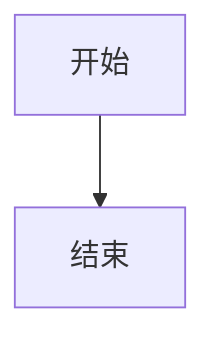

# 一级标题：格式保存全项验收（2026-10-08）

## 二级标题：基础文本与排版

### 三级标题：样式展示

#### 四级标题：多语言混合

##### 五级标题：内联元素

###### 六级标题：特殊符号

这是一段用于测试的中文正文，包含 English 单词。**粗体文本**需要加粗显示，_斜体文本_应该倾斜，_**粗斜体**_则同时具备两种效果。~~删除线~~表示被删除的内容。行内代码如 `print("hello")` 应有背景色。带反引号的行内代码：`` `rm -rf /` ``。

显式换行：这一行之后有一个 `<br>` 式的换行，现在应该在新行。

## 二级标题：列表与引用

### 无序列表

-   第一项：苹果
    
-   第二项：香蕉
    
    -   嵌套第一项：红香蕉
        
    -   嵌套第二项：绿香蕉
        
    
-   第三项：橙子
    

### 有序列表（从3开始）

3.  第三步：准备数据
    
4.  第四步：处理数据
    
5.  第五步：输出结果
    

### 任务列表

-   [x] 完成标题测试
    
-   [x] 完成列表测试
    
-   [ ] 完成表格测试
    
-   [ ] 完成公式测试
    

### 引用

> 这是第一层引用。
> 
> > 这是第二层嵌套引用，用于测试多层引用样式。

* * *

## 二级标题：代码块

### JavaScript 代码块

```javascript
async function fetchData() {
    const url = "https://api.example.com/data";
    const response = await fetch(url);
    
    
    console.log("Price: $100");
    console.log(`Template string with backticks: \`\`\``);
}
```

### Python 代码块

```python
def calculate_sum(a, b):
    # 这是一个中文注释：计算两数之和
    result = a + b
    
    
    return result
```

### Text 代码块

```text
**bold**
## heading
$E=mc^2$
反斜杠：\
```

## 二级标题：表格

| 左对齐列 | 居中对齐列 | 右对齐列 | 左对齐列 |
| --- | :---: | ---: | --- |
| 中文内容 | _斜体文本_ | $x_i^2$ | 123 |
| 竖线 \| 测试 | 数字 456 | 价格 \$100 | 第一行内容<br>第二行内容 |

## 二级标题：数学公式

### 行内公式

分数：$\frac{a}{b}$，上下标：$x_i^2$，希腊字母：$\alpha + \beta = \gamma$，根号：$\sqrt{x^2 + y^2}$，求和：$\sum_{i=1}^{n} i$。

### 独立公式

嵌套分数：

$$
\frac{1}{1 + \frac{1}{1 + \frac{1}{1 + x}}}
$$

积分：

$$
\int_{0}^{\infty} e^{-x^2} dx = \frac{\sqrt{\pi}}{2}
$$

Beta函数与Gamma函数关系：

$$
B(x, y) = \frac{\Gamma(x)\Gamma(y)}{\Gamma(x+y)}
$$

组合数：

$$
\binom{n}{k} = \frac{n!}{k!(n-k)!}
$$

2×2矩阵：

$$
\begin{pmatrix}
a & b \\
c & d
\end{pmatrix}
$$

分段函数：

$$
f(x) = 
\begin{cases} 
x^2 & \text{if } x \geq 0 \\
-x & \text{if } x < 0 
\end{cases}
$$

Aligned两行方程：

$$
\begin{aligned}
x + y &= 10 \\
2x - y &= 5
\end{aligned}
$$

## 二级标题：链接、图片与脚注

普通网页链接：[https://katex.org/docs/supported](https://katex.org/docs/supported) 和 [https://www.python.org/](https://www.python.org/)。

带链接的图片：[https://www.python.org/static/community\_logos/python-logo.png](https://www.python.org/static/community_logos/python-logo.png)

脚注示例：这里需要一个脚注。

: 这是脚注的定义，用于说明测试内容。

## 二级标题：Mermaid 与特殊字符

### Mermaid 流程图



### 特殊字符

特殊字符 & < > | \* \_ 应该正常显示，不能误当公式。价格 \$100 和 \$9.99 应保持原样。

## 验收清单

-   [x] 一至六级标题各一个
    
-   [x] 中文、English、**粗体**、_斜体_**粗斜体**\*、~~删除线~~、行内代码、带反引号的行内代码、显式换行
    
-   [x] 无序列表、有序列表（从3开始）、两层嵌套列表、四项任务列表
    
-   [x] 两层引用与分隔线
    
-   [x] 三个带语言标签的独立代码块（javascript、python、text）
    
-   [x] 四列表格（左、中、右、左对齐，含中文、斜体、行内公式、数字、竖线、两行内容）
    
-   [x] 12个真实渲染的数学公式（5行内、7独立）
    
-   [x] 普通网页链接、图片、带链接的图片、脚注
    
-   [x] Mermaid 流程图代码块
    
-   [x] 特殊字符 & < > | \* \_ 和价格 \$100、\$9.99