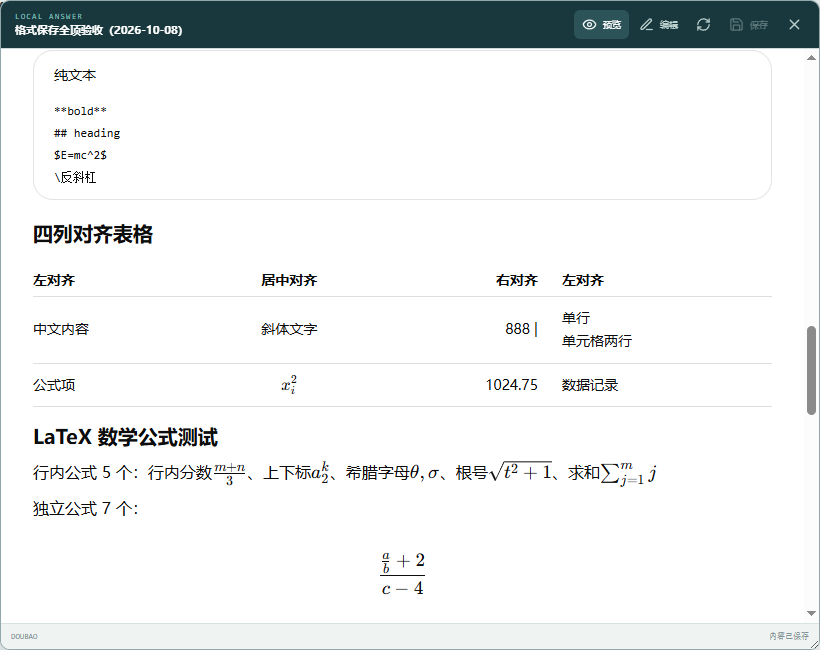
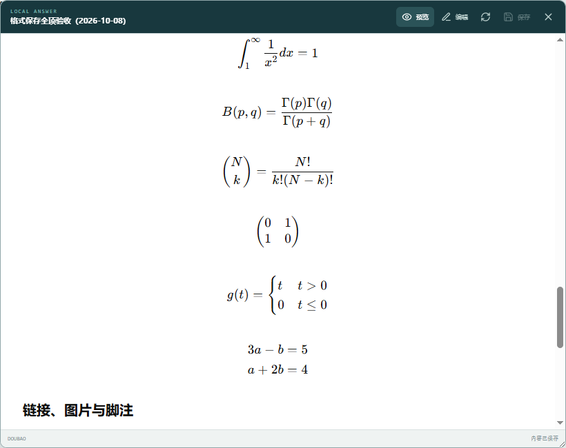
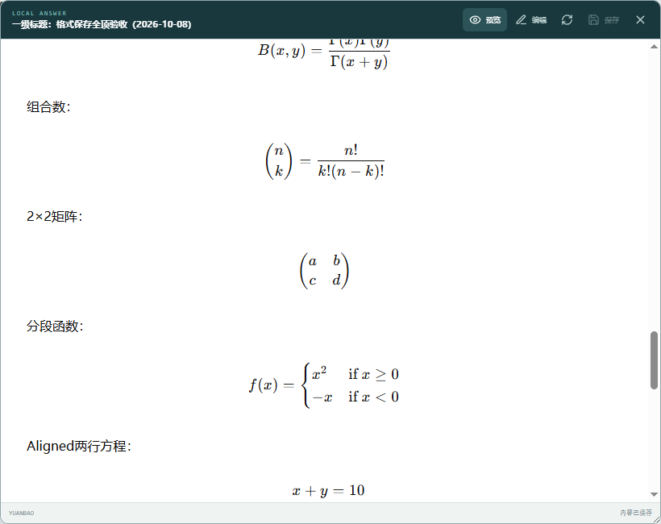

# 三个平台回答格式保存验收

日期：2026-10-08。目标：豆包、腾讯元宝分别适配，并保持 ChatGPT 原有转换结果。

## 保存的笔记

- [ChatGPT 原样本回归笔记](chatgpt-saved-note.md)
- [腾讯元宝真实回答样本笔记](yuanbao-saved-note.md)
- [豆包真实回答样本笔记](doubao-saved-note.md)

这些文件由生产 Electron 预加载脚本、IPC 和工作区保存流程生成。测试将真实回答 DOM 在对应平台的测试地址重放，笔记中的 `sourceUrl` 因此是 `format-fixture` 地址；原始网页地址如下。测试工作区为临时目录，以上副本永久保留在本目录。

- 元宝：[测试对话](https://yuanbao.tencent.com/chat/naQivTmsDa/0R4wZPfKnVg)。原始 DOM 与公式/代码见 `yuanbao-source.json`。
- 豆包：[测试对话](https://www.doubao.com/chat/38446150014766082)。原始 DOM 与公式/代码见 `doubao-source.json`。采用第二条完整聊天正文回答；第一条自动生成的侧边文档不作为聊天回答样本。
- ChatGPT：沿用 2026-10-05 已验收的真实 DOM 和 Markdown 基线。

## 格式结果

| 验证项 | ChatGPT | 腾讯元宝 | 豆包 |
| --- | --- | --- | --- |
| Markdown 正文 | 与原基线逐字一致 | 独立适配器 | 独立适配器 |
| 数学公式总数 / 独立公式 | 12 / 7 | 13 / 7 | 13 / 7 |
| 公式错误 | 0 | 0 | 0 |
| 代码块数量 | 3 | 4（含 Mermaid） | 4（含 Mermaid） |
| 代码语言、缩进与空行 | 与源 DOM 一致 | 与源 DOM 一致 | 与源 DOM 一致 |
| 表格对齐 | 原有规则 | 左 / 中 / 右 / 左 | 左 / 中 / 右 / 左 |
| 表格单元格换行 | 原有规则 | 保留 | 保留 |
| 任务列表 | 完成/未完成保留 | 完成/未完成保留 | 完成/未完成保留 |
| 图片 | 原有规则 | 网站未输出图片节点 | 已加载 Python 图片 URL 保留 |

另用离线格式矩阵检查：1–6 级标题、粗体/斜体/删除线、带反引号的行内代码、从 3 开始的有序列表、嵌套列表/引用、分隔线、任务状态、相对/安全链接、图片、规范脚注、价格美元符号、多语言代码、连续空行、代码内反引号、表格竖线及换行，以及分数、上下标、根号、求和、积分、Beta 函数、组合数、矩阵、分段函数和多行对齐公式。离线样例覆盖格式边界，不能代替网站实际提供某种格式的证明。

## 平台隔离

- ChatGPT 继续直接委托原 `chatgpt-adapter.ts` 和 `shared/content.ts`，两个文件在本次格式修改前后 SHA256 不变；真实样本 Markdown 完整比对通过。
- 元宝读取 `data-latex`，修复自定义列表编号、嵌套代码和 Markdown 段落包装。
- 豆包读取 `copy-text`，处理独立公式、空 div 换行、代码工具栏、多段回答正文、链接按钮和重定向链接。
- 两个新平台共用独立序列化工具；阅读器表格换行、链接图片尺寸及公式留白仅对豆包/元宝启用。
- 捕获跳过流式回答和页面操作控件，处理克隆 DOM；不修改原始网页，不执行保存的 HTML。

## 截图

### 豆包表格

### 豆包公式

### 元宝公式

完整计数、布局测量和图片 URL 见三个 `*-format-report.json`。原站截图见 `doubao-source.png`、`yuanbao-source.png`。

## 验证命令与结果

- `pnpm test`：35 个文件，188 项通过。最终豆包工具栏过滤修改后，针对性 9 项格式测试再次通过。
- `pnpm typecheck`、`pnpm lint`、`pnpm build`：通过。
- `pnpm test:e2e tests/e2e/provider-format.spec.ts`：三个平台全部通过，覆盖捕获、磁盘保存、导图关联、阅读器和原始代码对照。
- 全应用端到端首轮 12/14 通过：发现豆包高公式顶部裁切，已以平台专属留白修复并通过格式复测；另一个已有项目拖拽测试首轮失败，未改动相关功能，单独复跑通过。补充截图步骤的一次 ChatGPT 多表格定位错误已修正为定位第一张表，最终三平台再次全部通过。

## 实际限制

- 元宝该回答把图片输出为普通 URL，并没有图片节点；脚注标识缺失，删除线也是原站的字面文本。保存可见内容，不猜测缺失的结构。
- 豆包样本的脚注是模型生成的普通链接，不是规范脚注；保留可读取内容。规范脚注使用离线 DOM 单独测试。
- 豆包样本把标称“六级标题”写成七个 `#`，按网站真实渲染内容保存；合法 1–6 级标题另有矩阵测试。
- 懒加载图片需要先在原站加载，使 DOM 提供真实 URL。这里只保存图片链接，不下载附件；离线显示仍依赖图片可访问性。
- Mermaid 保存源码，阅读器显示代码块；不重新生成原网站的图像或执行图表脚本。
- 平台自定义卡片、音视频、云端文档、图片附件及缺少 DOM 原始信息的内容，未承诺像素级还原。

## 复用检查

复用项目已有 MIT 许可的 [Turndown](https://github.com/mixmark-io/turndown) 和 [Turndown GFM](https://github.com/mixmark-io/turndown-plugin-gfm)；网站特有 DOM 用小型适配器处理。本次没有添加依赖。
