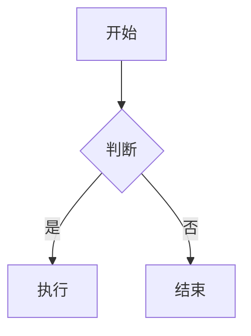

# 回答格式验收

## 一级标题

### 二级标题

#### 三级标题

##### 四级标题

###### 五级标题

###### 六级标题

中文 English 混排：**粗体**、_斜体_、~~删除线~~、`行内代码`。

嵌套有序无序列表：

1.  有序第一项
    
    -   无序子项 A
        
    -   无序子项 B
        
        1.  有序孙项 1
            
        2.  有序孙项 2
            
2.  有序第二项
    
    -   无序子项 C
        

有序列表从 3 开始：

3.  第三项
    
4.  第四项
    
5.  第五项
    

任务列表：

-   [x] 已完成任务
-   [ ] 未完成任务

嵌套引用：

> 第一层引用
> 
> > 第二层引用
> > 
> > > 第三层引用

* * *

| 左对齐 | 居中 | 右对齐 | 含竖线与换行 |
| :--- | :--- | :--- | :--- |
| 左 | 中 | 右 | 单元格里有竖线：\| 以及换行：<br>第二行 |
| A | B | C | `$100` 与 `$9.99` |

HTTPS 链接：[OpenAI](https://www.openai.com/)

Markdown 图片：[https://via.placeholder.com/120x40.png](https://via.placeholder.com/120x40.png "占位图")

脚注引用：[^1] 以及另一个脚注：[^note]

价格：\$100 与 \$9.99。

JavaScript 代码块：

```javascript
function greet(name) {
  const msg = `Hello, ${name}!`;
  // 空行与缩进保留

  return msg;
}

console.log(greet("World"));
```

Python 代码块：

```python
def calc(x):
    total = x + 100
    # 空行与缩进保留

    return total

print(calc(5))
```

Mermaid 代码块：



纯文本代码块：

```text
保留缩进：
    第一行
        第二行

空行上方有一个空行
反引号：`
美元：$100
```

LaTeX 行内公式 5 个：$a^2 + b^2 = c^2$、$\frac{1}{2}$、$\sqrt{x}$、$\sum_{i=1}^{n} i$、$\alpha + \beta$。

LaTeX 独立公式 7 个：

$$
\int_0^1 x^2 \, dx = \frac{1}{3}
$$

$$
\binom{n}{k} = \frac{n!}{k!(n-k)!}
$$

$$
\begin{matrix}
a & b \\
c & d
\end{matrix}
$$

$$
f(x) =
\begin{cases}
x^2, & x \ge 0 \\
-x, & x < 0
\end{cases}
$$

$$
\begin{aligned}
y &= (x+1)^2 \\
  &= x^2 + 2x + 1
\end{aligned}
$$

$$
\sum_{i=1}^{n} i^2 = \frac{n(n+1)(2n+1)}{6}
$$

$$
\sqrt[3]{x} + \alpha\beta \ge \gamma
$$

[^1]: 这是第一个脚注。

[^note]: 这是带名称的脚注。