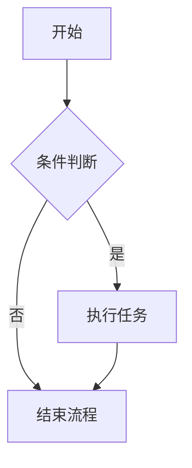

# 回答格式验收

## 一级标题 H1

### 三级标题 H3

###### 六级标题 H6

这是一段包含 中文English 混排的**粗体**、_斜体_、~~删除线~~、`行内代码`（含反引号可用 `` `code` ``）的正文。

* * *

## 列表

1.  有序列表第一项
    
    -   无序子项 A
        
        1.  嵌套有序子项
            
    -   无序子项 B
        
2.  有序列表第二项
    

从 3 开始的有序列表：

3.  第三项
    
4.  第四项
    
    -   混合无序子项
        
        -   更深的无序子项
            

任务列表：

-   [x] 已完成任务
    
-   [ ] 未完成任务
    
    -   [x] 已完成的子任务
        

> 外层引用
> 
> > 内层引用
> > 
> > > 第三层引用 回到外层

* * *

## 表格

| 左对齐 | 居中对齐 | 右对齐 | 默认对齐 |
| :--- | :---: | ---: | :--- |
| 左内容 | 中内容 | 右内容 | 含竖线 a\|b |
| 换行<br>第二行 | 中<br>央 | 100 | c\|d\|e |

## 链接、图片、脚注、价格

访问 [Example 官网](https://example.com/) 了解更多。

[https://picsum.photos/150](https://picsum.photos/150)

这是一个带脚注的句子。[^note]

价格示例：商品 A 售价 \$100，商品 B 售价 \$9.99。

[^note]: 这是脚注内容，支持 _Markdown_ 语法。

## 代码块

```javascript
const price = 100; // $100
let total = `$${(9.99).toFixed(2)}`;

function greet(name) {
  return `Hello, ${name}`;
}

console.log(greet("World"));
```

```python
def fib(n):
    if n < 2:
        return n
    return fib(n - 1) + fib(n - 2)

print(fib(10))  # 55
```



```text
# 纯文本代码块
保留缩进    和空行

`echo "hello"`
total = $100 + $9.99
```

## LaTeX 公式

行内公式（5 个）：

分式


```mindmap-ui
{"html":"<span class=\"katex-wrapper\" style=\"width: 16.1875px; height: auto; font-size: 16px; line-height: 26px; display: inline-block; max-width: 100%; color: rgba(0, 0, 0, 0.9);\"><span class=\"katex-container\"><span class=\"katex\"><span class=\"katex-html\" aria-hidden=\"true\"><span class=\"base\"><span class=\"strut\" style=\"height:1.0404em;vertical-align:-0.345em;\"></span><span class=\"mord\"><span class=\"mopen nulldelimiter\"></span><span class=\"mfrac\"><span class=\"vlist-t vlist-t2\"><span class=\"vlist-r\"><span class=\"vlist\" style=\"height:0.6954em;\"><span style=\"top:-2.655em;\"><span class=\"pstrut\" style=\"height:3em;\"></span><span class=\"sizing reset-size6 size3 mtight\"><span class=\"mord mtight\"><span class=\"mord mathnormal mtight\">b</span></span></span></span><span style=\"top:-3.23em;\"><span class=\"pstrut\" style=\"height:3em;\"></span><span class=\"frac-line\" style=\"border-bottom-width:0.04em;\"></span></span><span style=\"top:-3.394em;\"><span class=\"pstrut\" style=\"height:3em;\"></span><span class=\"sizing reset-size6 size3 mtight\"><span class=\"mord mtight\"><span class=\"mord mathnormal mtight\">a</span></span></span></span></span><span class=\"vlist-s\">​</span></span><span class=\"vlist-r\"><span class=\"vlist\" style=\"height:0.345em;\"><span></span></span></span></span></span><span class=\"mclose nulldelimiter\"></span></span></span></span></span></span> <!----></span>","height":79,"width":49,"formula":true,"inline":true}
```


，根号


```mindmap-ui
{"html":"<span class=\"katex-wrapper\" style=\"width: 72.6719px; height: auto; font-size: 16px; line-height: 26px; display: inline-block; max-width: 100%; color: rgba(0, 0, 0, 0.9);\"><span class=\"katex-container\"><span class=\"katex\"><span class=\"katex-html\" aria-hidden=\"true\"><span class=\"base\"><span class=\"strut\" style=\"height:1.04em;vertical-align:-0.1266em;\"></span><span class=\"mord sqrt\"><span class=\"vlist-t vlist-t2\"><span class=\"vlist-r\"><span class=\"vlist\" style=\"height:0.9134em;\"><span class=\"svg-align\" style=\"top:-3em;\"><span class=\"pstrut\" style=\"height:3em;\"></span><span class=\"mord\" style=\"padding-left:0.833em;\"><span class=\"mord\"><span class=\"mord mathnormal\">x</span><span class=\"msupsub\"><span class=\"vlist-t\"><span class=\"vlist-r\"><span class=\"vlist\" style=\"height:0.7401em;\"><span style=\"top:-2.989em;margin-right:0.05em;\"><span class=\"pstrut\" style=\"height:2.7em;\"></span><span class=\"sizing reset-size6 size3 mtight\"><span class=\"mord mtight\">2</span></span></span></span></span></span></span></span><span class=\"mspace\" style=\"margin-right:0.2222em;\"></span><span class=\"mbin\">+</span><span class=\"mspace\" style=\"margin-right:0.2222em;\"></span><span class=\"mord\">1</span></span></span><span style=\"top:-2.8734em;\"><span class=\"pstrut\" style=\"height:3em;\"></span><span class=\"hide-tail\" style=\"min-width:0.853em;height:1.08em;\"><svg width=\"400em\" height=\"1.08em\" viewBox=\"0 0 400000 1080\" preserveAspectRatio=\"xMinYMin slice\"><path d=\"M95,702\nc-2.7,0,-7.17,-2.7,-13.5,-8c-5.8,-5.3,-9.5,-10,-9.5,-14\nc0,-2,0.3,-3.3,1,-4c1.3,-2.7,23.83,-20.7,67.5,-54\nc44.2,-33.3,65.8,-50.3,66.5,-51c1.3,-1.3,3,-2,5,-2c4.7,0,8.7,3.3,12,10\ns173,378,173,378c0.7,0,35.3,-71,104,-213c68.7,-142,137.5,-285,206.5,-429\nc69,-144,104.5,-217.7,106.5,-221\nl0 -0\nc5.3,-9.3,12,-14,20,-14\nH400000v40H845.2724\ns-225.272,467,-225.272,467s-235,486,-235,486c-2.7,4.7,-9,7,-19,7\nc-6,0,-10,-1,-12,-3s-194,-422,-194,-422s-65,47,-65,47z\nM834 80h400000v40h-400000z\"></path></svg></span></span></span><span class=\"vlist-s\">​</span></span><span class=\"vlist-r\"><span class=\"vlist\" style=\"height:0.1266em;\"><span></span></span></span></span></span></span></span></span></span> <!----></span>","height":79,"width":105,"formula":true,"inline":true}
```


，上下标


```mindmap-ui
{"html":"<span class=\"katex-wrapper\" style=\"width: 78.7344px; height: auto; font-size: 16px; line-height: 26px; display: inline-block; max-width: 100%; color: rgba(0, 0, 0, 0.9);\"><span class=\"katex-container\"><span class=\"katex\"><span class=\"katex-html\" aria-hidden=\"true\"><span class=\"base\"><span class=\"strut\" style=\"height:0.6833em;\"></span><span class=\"mord mathnormal\" style=\"margin-right:0.05764em;\">E</span><span class=\"mspace\" style=\"margin-right:0.2778em;\"></span><span class=\"mrel\">=</span><span class=\"mspace\" style=\"margin-right:0.2778em;\"></span></span><span class=\"base\"><span class=\"strut\" style=\"height:0.8141em;\"></span><span class=\"mord mathnormal\">m</span><span class=\"mord\"><span class=\"mord mathnormal\">c</span><span class=\"msupsub\"><span class=\"vlist-t\"><span class=\"vlist-r\"><span class=\"vlist\" style=\"height:0.8141em;\"><span style=\"top:-3.063em;margin-right:0.05em;\"><span class=\"pstrut\" style=\"height:2.7em;\"></span><span class=\"sizing reset-size6 size3 mtight\"><span class=\"mord mtight\">2</span></span></span></span></span></span></span></span></span></span></span></span> <!----></span>","height":80,"width":111,"formula":true,"inline":true}
```


与


```mindmap-ui
{"html":"<span class=\"katex-wrapper\" style=\"width: 22.375px; height: auto; font-size: 16px; line-height: 26px; display: inline-block; max-width: 100%; color: rgba(0, 0, 0, 0.9);\"><span class=\"katex-container\"><span class=\"katex\"><span class=\"katex-html\" aria-hidden=\"true\"><span class=\"base\"><span class=\"strut\" style=\"height:1.0728em;vertical-align:-0.2587em;\"></span><span class=\"mord\"><span class=\"mord mathnormal\">a</span><span class=\"msupsub\"><span class=\"vlist-t vlist-t2\"><span class=\"vlist-r\"><span class=\"vlist\" style=\"height:0.8141em;\"><span style=\"top:-2.4413em;margin-left:0em;margin-right:0.05em;\"><span class=\"pstrut\" style=\"height:2.7em;\"></span><span class=\"sizing reset-size6 size3 mtight\"><span class=\"mord mathnormal mtight\">i</span></span></span><span style=\"top:-3.063em;margin-right:0.05em;\"><span class=\"pstrut\" style=\"height:2.7em;\"></span><span class=\"sizing reset-size6 size3 mtight\"><span class=\"mord mtight\">2</span></span></span></span><span class=\"vlist-s\">​</span></span><span class=\"vlist-r\"><span class=\"vlist\" style=\"height:0.2587em;\"><span></span></span></span></span></span></span></span></span></span></span> <!----></span>","height":80,"width":55,"formula":true,"inline":true}
```


，希腊字母


```mindmap-ui
{"html":"<span class=\"katex-wrapper\" style=\"width: 89.3906px; height: auto; font-size: 16px; line-height: 26px; display: inline-block; max-width: 100%; color: rgba(0, 0, 0, 0.9);\"><span class=\"katex-container\"><span class=\"katex\"><span class=\"katex-html\" aria-hidden=\"true\"><span class=\"base\"><span class=\"strut\" style=\"height:0.6667em;vertical-align:-0.0833em;\"></span><span class=\"mord mathnormal\" style=\"margin-right:0.0037em;\">α</span><span class=\"mspace\" style=\"margin-right:0.2222em;\"></span><span class=\"mbin\">+</span><span class=\"mspace\" style=\"margin-right:0.2222em;\"></span></span><span class=\"base\"><span class=\"strut\" style=\"height:0.8889em;vertical-align:-0.1944em;\"></span><span class=\"mord mathnormal\" style=\"margin-right:0.05278em;\">β</span><span class=\"mspace\" style=\"margin-right:0.2778em;\"></span><span class=\"mrel\">=</span><span class=\"mspace\" style=\"margin-right:0.2778em;\"></span></span><span class=\"base\"><span class=\"strut\" style=\"height:0.625em;vertical-align:-0.1944em;\"></span><span class=\"mord mathnormal\" style=\"margin-right:0.05556em;\">γ</span></span></span></span></span> <!----></span>","height":80,"width":122,"formula":true,"inline":true}
```


，求和


```mindmap-ui
{"html":"<span class=\"katex-wrapper\" style=\"width: 64.5312px; height: auto; font-size: 16px; line-height: 26px; display: inline-block; max-width: 100%; color: rgba(0, 0, 0, 0.9);\"><span class=\"katex-container\"><span class=\"katex\"><span class=\"katex-html\" aria-hidden=\"true\"><span class=\"base\"><span class=\"strut\" style=\"height:1.104em;vertical-align:-0.2997em;\"></span><span class=\"mop\"><span class=\"mop op-symbol small-op\" style=\"position:relative;top:0em;\">∑</span><span class=\"msupsub\"><span class=\"vlist-t vlist-t2\"><span class=\"vlist-r\"><span class=\"vlist\" style=\"height:0.8043em;\"><span style=\"top:-2.4003em;margin-left:0em;margin-right:0.05em;\"><span class=\"pstrut\" style=\"height:2.7em;\"></span><span class=\"sizing reset-size6 size3 mtight\"><span class=\"mord mtight\"><span class=\"mord mathnormal mtight\" style=\"margin-right:0.03148em;\">k</span><span class=\"mrel mtight\">=</span><span class=\"mord mtight\">1</span></span></span></span><span style=\"top:-3.2029em;margin-right:0.05em;\"><span class=\"pstrut\" style=\"height:2.7em;\"></span><span class=\"sizing reset-size6 size3 mtight\"><span class=\"mord mtight\"><span class=\"mord mathnormal mtight\">n</span></span></span></span></span><span class=\"vlist-s\">​</span></span><span class=\"vlist-r\"><span class=\"vlist\" style=\"height:0.2997em;\"><span></span></span></span></span></span></span><span class=\"mspace\" style=\"margin-right:0.1667em;\"></span><span class=\"mord mathnormal\" style=\"margin-right:0.03148em;\">k</span></span></span></span></span> <!----></span>","height":81,"width":97,"formula":true,"inline":true}
```


。

独立显示公式（7 组，共 10 个）：


```mindmap-ui
{"html":"<span class=\"katex-wrapper math-display markdown-math\" style=\"width: 720px; height: auto; font-size: 14px; line-height: 22px; display: block; max-width: 100%; color: rgba(0, 0, 0, 0.9);\"><span class=\"katex-container math-display\"><span class=\"katex-display\"><span class=\"katex\"><span class=\"katex-html\" aria-hidden=\"true\"><span class=\"base\"><span class=\"strut\" style=\"height:2.0574em;vertical-align:-0.686em;\"></span><span class=\"mord\"><span class=\"mopen nulldelimiter\"></span><span class=\"mfrac\"><span class=\"vlist-t vlist-t2\"><span class=\"vlist-r\"><span class=\"vlist\" style=\"height:1.3714em;\"><span style=\"top:-2.314em;\"><span class=\"pstrut\" style=\"height:3em;\"></span><span class=\"mord\"><span class=\"mord mathnormal\">d</span><span class=\"mord mathnormal\">x</span></span></span><span style=\"top:-3.23em;\"><span class=\"pstrut\" style=\"height:3em;\"></span><span class=\"frac-line\" style=\"border-bottom-width:0.04em;\"></span></span><span style=\"top:-3.677em;\"><span class=\"pstrut\" style=\"height:3em;\"></span><span class=\"mord\"><span class=\"mord mathnormal\">d</span><span class=\"mord mathnormal\" style=\"margin-right:0.03588em;\">y</span></span></span></span><span class=\"vlist-s\">​</span></span><span class=\"vlist-r\"><span class=\"vlist\" style=\"height:0.686em;\"><span></span></span></span></span></span><span class=\"mclose nulldelimiter\"></span></span><span class=\"mspace\" style=\"margin-right:0.2778em;\"></span><span class=\"mrel\">=</span><span class=\"mspace\" style=\"margin-right:0.2778em;\"></span></span><span class=\"base\"><span class=\"strut\" style=\"height:2.1791em;vertical-align:-0.7521em;\"></span><span class=\"mop op-limits\"><span class=\"vlist-t vlist-t2\"><span class=\"vlist-r\"><span class=\"vlist\" style=\"height:0.6944em;\"><span style=\"top:-2.3479em;margin-left:0em;\"><span class=\"pstrut\" style=\"height:3em;\"></span><span class=\"sizing reset-size6 size3 mtight\"><span class=\"mord mtight\"><span class=\"mord mathnormal mtight\">h</span><span class=\"mrel mtight\">→</span><span class=\"mord mtight\">0</span></span></span></span><span style=\"top:-3em;\"><span class=\"pstrut\" style=\"height:3em;\"></span><span><span class=\"mop\">lim</span></span></span></span><span class=\"vlist-s\">​</span></span><span class=\"vlist-r\"><span class=\"vlist\" style=\"height:0.7521em;\"><span></span></span></span></span></span><span class=\"mspace\" style=\"margin-right:0.1667em;\"></span><span class=\"mord\"><span class=\"mopen nulldelimiter\"></span><span class=\"mfrac\"><span class=\"vlist-t vlist-t2\"><span class=\"vlist-r\"><span class=\"vlist\" style=\"height:1.427em;\"><span style=\"top:-2.314em;\"><span class=\"pstrut\" style=\"height:3em;\"></span><span class=\"mord\"><span class=\"mord mathnormal\">h</span></span></span><span style=\"top:-3.23em;\"><span class=\"pstrut\" style=\"height:3em;\"></span><span class=\"frac-line\" style=\"border-bottom-width:0.04em;\"></span></span><span style=\"top:-3.677em;\"><span class=\"pstrut\" style=\"height:3em;\"></span><span class=\"mord\"><span class=\"mord mathnormal\" style=\"margin-right:0.10764em;\">f</span><span class=\"mopen\">(</span><span class=\"mord mathnormal\">x</span><span class=\"mspace\" style=\"margin-right:0.2222em;\"></span><span class=\"mbin\">+</span><span class=\"mspace\" style=\"margin-right:0.2222em;\"></span><span class=\"mord mathnormal\">h</span><span class=\"mclose\">)</span><span class=\"mspace\" style=\"margin-right:0.2222em;\"></span><span class=\"mbin\">−</span><span class=\"mspace\" style=\"margin-right:0.2222em;\"></span><span class=\"mord mathnormal\" style=\"margin-right:0.10764em;\">f</span><span class=\"mopen\">(</span><span class=\"mord mathnormal\">x</span><span class=\"mclose\">)</span></span></span></span><span class=\"vlist-s\">​</span></span><span class=\"vlist-r\"><span class=\"vlist\" style=\"height:0.686em;\"><span></span></span></span></span></span><span class=\"mclose nulldelimiter\"></span></span></span></span></span></span></span> <!----></span>","height":106,"width":752,"formula":true,"inline":false}
```


```mindmap-ui
{"html":"<span class=\"katex-wrapper math-display markdown-math\" style=\"width: 720px; height: auto; font-size: 14px; line-height: 22px; display: block; max-width: 100%; color: rgba(0, 0, 0, 0.9);\"><span class=\"katex-container math-display\"><span class=\"katex-display\"><span class=\"katex\"><span class=\"katex-html\" aria-hidden=\"true\"><span class=\"base\"><span class=\"strut\" style=\"height:1.04em;vertical-align:-0.1109em;\"></span><span class=\"mord sqrt\"><span class=\"root\"><span class=\"vlist-t\"><span class=\"vlist-r\"><span class=\"vlist\" style=\"height:0.7062em;\"><span style=\"top:-2.9909em;\"><span class=\"pstrut\" style=\"height:2.5em;\"></span><span class=\"sizing reset-size6 size1 mtight\"><span class=\"mord mtight\"><span class=\"mord mathnormal mtight\">n</span></span></span></span></span></span></span></span><span class=\"vlist-t vlist-t2\"><span class=\"vlist-r\"><span class=\"vlist\" style=\"height:0.9291em;\"><span class=\"svg-align\" style=\"top:-3em;\"><span class=\"pstrut\" style=\"height:3em;\"></span><span class=\"mord\" style=\"padding-left:0.833em;\"><span class=\"mord\"><span class=\"mord mathnormal\">x</span><span class=\"msupsub\"><span class=\"vlist-t\"><span class=\"vlist-r\"><span class=\"vlist\" style=\"height:0.5904em;\"><span style=\"top:-2.989em;margin-right:0.05em;\"><span class=\"pstrut\" style=\"height:2.7em;\"></span><span class=\"sizing reset-size6 size3 mtight\"><span class=\"mord mathnormal mtight\">n</span></span></span></span></span></span></span></span></span></span><span style=\"top:-2.8891em;\"><span class=\"pstrut\" style=\"height:3em;\"></span><span class=\"hide-tail\" style=\"min-width:0.853em;height:1.08em;\"><svg width=\"400em\" height=\"1.08em\" viewBox=\"0 0 400000 1080\" preserveAspectRatio=\"xMinYMin slice\"><path d=\"M95,702\nc-2.7,0,-7.17,-2.7,-13.5,-8c-5.8,-5.3,-9.5,-10,-9.5,-14\nc0,-2,0.3,-3.3,1,-4c1.3,-2.7,23.83,-20.7,67.5,-54\nc44.2,-33.3,65.8,-50.3,66.5,-51c1.3,-1.3,3,-2,5,-2c4.7,0,8.7,3.3,12,10\ns173,378,173,378c0.7,0,35.3,-71,104,-213c68.7,-142,137.5,-285,206.5,-429\nc69,-144,104.5,-217.7,106.5,-221\nl0 -0\nc5.3,-9.3,12,-14,20,-14\nH400000v40H845.2724\ns-225.272,467,-225.272,467s-235,486,-235,486c-2.7,4.7,-9,7,-19,7\nc-6,0,-10,-1,-12,-3s-194,-422,-194,-422s-65,47,-65,47z\nM834 80h400000v40h-400000z\"></path></svg></span></span></span><span class=\"vlist-s\">​</span></span><span class=\"vlist-r\"><span class=\"vlist\" style=\"height:0.1109em;\"><span></span></span></span></span></span><span class=\"mspace\" style=\"margin-right:0.2778em;\"></span><span class=\"mrel\">=</span><span class=\"mspace\" style=\"margin-right:0.2778em;\"></span></span><span class=\"base\"><span class=\"strut\" style=\"height:1.2472em;vertical-align:-0.3831em;\"></span><span class=\"mord mathnormal\">x</span><span class=\"mpunct\">,</span><span class=\"mspace\" style=\"margin-right:2em;\"></span><span class=\"mspace\" style=\"margin-right:0.1667em;\"></span><span class=\"mord\"><span class=\"mord mathnormal\">a</span><span class=\"msupsub\"><span class=\"vlist-t vlist-t2\"><span class=\"vlist-r\"><span class=\"vlist\" style=\"height:0.8641em;\"><span style=\"top:-2.453em;margin-left:0em;margin-right:0.05em;\"><span class=\"pstrut\" style=\"height:2.7em;\"></span><span class=\"sizing reset-size6 size3 mtight\"><span class=\"mord mtight\"><span class=\"mord mathnormal mtight\" style=\"margin-right:0.05724em;\">ij</span></span></span></span><span style=\"top:-3.113em;margin-right:0.05em;\"><span class=\"pstrut\" style=\"height:2.7em;\"></span><span class=\"sizing reset-size6 size3 mtight\"><span class=\"mord mtight\">2</span></span></span></span><span class=\"vlist-s\">​</span></span><span class=\"vlist-r\"><span class=\"vlist\" style=\"height:0.3831em;\"><span></span></span></span></span></span></span><span class=\"mspace\" style=\"margin-right:0.2778em;\"></span><span class=\"mrel\">=</span><span class=\"mspace\" style=\"margin-right:0.2778em;\"></span></span><span class=\"base\"><span class=\"strut\" style=\"height:0.938em;\"></span><span class=\"mord\"><span class=\"mord mathnormal\">b</span><span class=\"msupsub\"><span class=\"vlist-t\"><span class=\"vlist-r\"><span class=\"vlist\" style=\"height:0.938em;\"><span style=\"top:-3.113em;margin-right:0.05em;\"><span class=\"pstrut\" style=\"height:2.7em;\"></span><span class=\"sizing reset-size6 size3 mtight\"><span class=\"mord mtight\"><span class=\"mopen mtight\">(</span><span class=\"mord mathnormal mtight\">n</span><span class=\"mbin mtight\">+</span><span class=\"mord mtight\">1</span><span class=\"mclose mtight\">)</span></span></span></span></span></span></span></span></span></span></span></span></span></span> <!----></span>","height":103,"width":752,"formula":true,"inline":false}
```


```mindmap-ui
{"html":"<span class=\"katex-wrapper math-display markdown-math\" style=\"width: 720px; height: auto; font-size: 14px; line-height: 22px; display: block; max-width: 100%; color: rgba(0, 0, 0, 0.9);\"><span class=\"katex-container math-display\"><span class=\"katex-display\"><span class=\"katex\"><span class=\"katex-html\" aria-hidden=\"true\"><span class=\"base\"><span class=\"strut\" style=\"height:0.6833em;\"></span><span class=\"mord\">Δ</span><span class=\"mspace\" style=\"margin-right:0.2778em;\"></span><span class=\"mrel\">=</span><span class=\"mspace\" style=\"margin-right:0.2778em;\"></span></span><span class=\"base\"><span class=\"strut\" style=\"height:0.9474em;vertical-align:-0.0833em;\"></span><span class=\"mord\"><span class=\"mord mathnormal\" style=\"margin-right:0.0037em;\">α</span><span class=\"msupsub\"><span class=\"vlist-t\"><span class=\"vlist-r\"><span class=\"vlist\" style=\"height:0.8641em;\"><span style=\"top:-3.113em;margin-right:0.05em;\"><span class=\"pstrut\" style=\"height:2.7em;\"></span><span class=\"sizing reset-size6 size3 mtight\"><span class=\"mord mtight\">2</span></span></span></span></span></span></span></span><span class=\"mspace\" style=\"margin-right:0.2222em;\"></span><span class=\"mbin\">−</span><span class=\"mspace\" style=\"margin-right:0.2222em;\"></span></span><span class=\"base\"><span class=\"strut\" style=\"height:0.8889em;vertical-align:-0.1944em;\"></span><span class=\"mord\">4</span><span class=\"mord mathnormal\" style=\"margin-right:0.05278em;\">β</span><span class=\"mord mathnormal\" style=\"margin-right:0.05556em;\">γ</span></span></span></span></span></span> <!----></span>","height":103,"width":752,"formula":true,"inline":false}
```


```mindmap-ui
{"html":"<span class=\"katex-wrapper math-display markdown-math\" style=\"width: 720px; height: auto; font-size: 14px; line-height: 22px; display: block; max-width: 100%; color: rgba(0, 0, 0, 0.9);\"><span class=\"katex-container math-display\"><span class=\"katex-display\"><span class=\"katex\"><span class=\"katex-html\" aria-hidden=\"true\"><span class=\"base\"><span class=\"strut\" style=\"height:2.9535em;vertical-align:-1.3021em;\"></span><span class=\"mop op-limits\"><span class=\"vlist-t vlist-t2\"><span class=\"vlist-r\"><span class=\"vlist\" style=\"height:1.6514em;\"><span style=\"top:-1.8479em;margin-left:0em;\"><span class=\"pstrut\" style=\"height:3.05em;\"></span><span class=\"sizing reset-size6 size3 mtight\"><span class=\"mord mtight\"><span class=\"mord mathnormal mtight\" style=\"margin-right:0.03148em;\">k</span><span class=\"mrel mtight\">=</span><span class=\"mord mtight\">1</span></span></span></span><span style=\"top:-3.05em;\"><span class=\"pstrut\" style=\"height:3.05em;\"></span><span><span class=\"mop op-symbol large-op\">∑</span></span></span><span style=\"top:-4.3em;margin-left:0em;\"><span class=\"pstrut\" style=\"height:3.05em;\"></span><span class=\"sizing reset-size6 size3 mtight\"><span class=\"mord mtight\"><span class=\"mord mathnormal mtight\">n</span></span></span></span></span><span class=\"vlist-s\">​</span></span><span class=\"vlist-r\"><span class=\"vlist\" style=\"height:1.3021em;\"><span></span></span></span></span></span><span class=\"mspace\" style=\"margin-right:0.1667em;\"></span><span class=\"mord\"><span class=\"mord mathnormal\" style=\"margin-right:0.03148em;\">k</span><span class=\"msupsub\"><span class=\"vlist-t\"><span class=\"vlist-r\"><span class=\"vlist\" style=\"height:0.8641em;\"><span style=\"top:-3.113em;margin-right:0.05em;\"><span class=\"pstrut\" style=\"height:2.7em;\"></span><span class=\"sizing reset-size6 size3 mtight\"><span class=\"mord mtight\">2</span></span></span></span></span></span></span></span><span class=\"mspace\" style=\"margin-right:0.2778em;\"></span><span class=\"mrel\">=</span><span class=\"mspace\" style=\"margin-right:0.2778em;\"></span></span><span class=\"base\"><span class=\"strut\" style=\"height:2.113em;vertical-align:-0.686em;\"></span><span class=\"mord\"><span class=\"mopen nulldelimiter\"></span><span class=\"mfrac\"><span class=\"vlist-t vlist-t2\"><span class=\"vlist-r\"><span class=\"vlist\" style=\"height:1.427em;\"><span style=\"top:-2.314em;\"><span class=\"pstrut\" style=\"height:3em;\"></span><span class=\"mord\"><span class=\"mord\">6</span></span></span><span style=\"top:-3.23em;\"><span class=\"pstrut\" style=\"height:3em;\"></span><span class=\"frac-line\" style=\"border-bottom-width:0.04em;\"></span></span><span style=\"top:-3.677em;\"><span class=\"pstrut\" style=\"height:3em;\"></span><span class=\"mord\"><span class=\"mord mathnormal\">n</span><span class=\"mopen\">(</span><span class=\"mord mathnormal\">n</span><span class=\"mspace\" style=\"margin-right:0.2222em;\"></span><span class=\"mbin\">+</span><span class=\"mspace\" style=\"margin-right:0.2222em;\"></span><span class=\"mord\">1</span><span class=\"mclose\">)</span><span class=\"mopen\">(</span><span class=\"mord\">2</span><span class=\"mord mathnormal\">n</span><span class=\"mspace\" style=\"margin-right:0.2222em;\"></span><span class=\"mbin\">+</span><span class=\"mspace\" style=\"margin-right:0.2222em;\"></span><span class=\"mord\">1</span><span class=\"mclose\">)</span></span></span></span><span class=\"vlist-s\">​</span></span><span class=\"vlist-r\"><span class=\"vlist\" style=\"height:0.686em;\"><span></span></span></span></span></span><span class=\"mclose nulldelimiter\"></span></span></span></span></span></span></span> <!----></span>","height":119,"width":752,"formula":true,"inline":false}
```


```mindmap-ui
{"html":"<span class=\"katex-wrapper math-display markdown-math\" style=\"width: 720px; height: auto; font-size: 14px; line-height: 22px; display: block; max-width: 100%; color: rgba(0, 0, 0, 0.9);\"><span class=\"katex-container math-display\"><span class=\"katex-display\"><span class=\"katex\"><span class=\"katex-html\" aria-hidden=\"true\"><span class=\"base\"><span class=\"strut\" style=\"height:2.3846em;vertical-align:-0.9703em;\"></span><span class=\"mop\"><span class=\"mop op-symbol large-op\" style=\"margin-right:0.44445em;position:relative;top:-0.0011em;\">∫</span><span class=\"msupsub\"><span class=\"vlist-t vlist-t2\"><span class=\"vlist-r\"><span class=\"vlist\" style=\"height:1.4143em;\"><span style=\"top:-1.7881em;margin-left:-0.4445em;margin-right:0.05em;\"><span class=\"pstrut\" style=\"height:2.7em;\"></span><span class=\"sizing reset-size6 size3 mtight\"><span class=\"mord mtight\"><span class=\"mord mtight\">−</span><span class=\"mord mtight\">∞</span></span></span></span><span style=\"top:-3.8129em;margin-right:0.05em;\"><span class=\"pstrut\" style=\"height:2.7em;\"></span><span class=\"sizing reset-size6 size3 mtight\"><span class=\"mord mtight\"><span class=\"mord mtight\">∞</span></span></span></span></span><span class=\"vlist-s\">​</span></span><span class=\"vlist-r\"><span class=\"vlist\" style=\"height:0.9703em;\"><span></span></span></span></span></span></span><span class=\"mspace\" style=\"margin-right:0.1667em;\"></span><span class=\"mord\"><span class=\"mord mathnormal\">e</span><span class=\"msupsub\"><span class=\"vlist-t\"><span class=\"vlist-r\"><span class=\"vlist\" style=\"height:1.0369em;\"><span style=\"top:-3.113em;margin-right:0.05em;\"><span class=\"pstrut\" style=\"height:2.7em;\"></span><span class=\"sizing reset-size6 size3 mtight\"><span class=\"mord mtight\"><span class=\"mord mtight\">−</span><span class=\"mord mtight\"><span class=\"mord mathnormal mtight\">x</span><span class=\"msupsub\"><span class=\"vlist-t\"><span class=\"vlist-r\"><span class=\"vlist\" style=\"height:0.8913em;\"><span style=\"top:-2.931em;margin-right:0.0714em;\"><span class=\"pstrut\" style=\"height:2.5em;\"></span><span class=\"sizing reset-size3 size1 mtight\"><span class=\"mord mtight\">2</span></span></span></span></span></span></span></span></span></span></span></span></span></span></span></span><span class=\"mspace\" style=\"margin-right:0.1667em;\"></span><span class=\"mord mathnormal\">d</span><span class=\"mord mathnormal\">x</span><span class=\"mspace\" style=\"margin-right:0.2778em;\"></span><span class=\"mrel\">=</span><span class=\"mspace\" style=\"margin-right:0.2778em;\"></span></span><span class=\"base\"><span class=\"strut\" style=\"height:1.04em;vertical-align:-0.1908em;\"></span><span class=\"mord sqrt\"><span class=\"vlist-t vlist-t2\"><span class=\"vlist-r\"><span class=\"vlist\" style=\"height:0.8492em;\"><span class=\"svg-align\" style=\"top:-3em;\"><span class=\"pstrut\" style=\"height:3em;\"></span><span class=\"mord\" style=\"padding-left:0.833em;\"><span class=\"mord mathnormal\" style=\"margin-right:0.03588em;\">π</span></span></span><span style=\"top:-2.8092em;\"><span class=\"pstrut\" style=\"height:3em;\"></span><span class=\"hide-tail\" style=\"min-width:0.853em;height:1.08em;\"><svg width=\"400em\" height=\"1.08em\" viewBox=\"0 0 400000 1080\" preserveAspectRatio=\"xMinYMin slice\"><path d=\"M95,702\nc-2.7,0,-7.17,-2.7,-13.5,-8c-5.8,-5.3,-9.5,-10,-9.5,-14\nc0,-2,0.3,-3.3,1,-4c1.3,-2.7,23.83,-20.7,67.5,-54\nc44.2,-33.3,65.8,-50.3,66.5,-51c1.3,-1.3,3,-2,5,-2c4.7,0,8.7,3.3,12,10\ns173,378,173,378c0.7,0,35.3,-71,104,-213c68.7,-142,137.5,-285,206.5,-429\nc69,-144,104.5,-217.7,106.5,-221\nl0 -0\nc5.3,-9.3,12,-14,20,-14\nH400000v40H845.2724\ns-225.272,467,-225.272,467s-235,486,-235,486c-2.7,4.7,-9,7,-19,7\nc-6,0,-10,-1,-12,-3s-194,-422,-194,-422s-65,47,-65,47z\nM834 80h400000v40h-400000z\"></path></svg></span></span></span><span class=\"vlist-s\">​</span></span><span class=\"vlist-r\"><span class=\"vlist\" style=\"height:0.1908em;\"><span></span></span></span></span></span></span></span></span></span></span> <!----></span>","height":109,"width":752,"formula":true,"inline":false}
```


```mindmap-ui
{"html":"<span class=\"katex-wrapper math-display markdown-math\" style=\"width: 720px; height: auto; font-size: 14px; line-height: 22px; display: block; max-width: 100%; color: rgba(0, 0, 0, 0.9);\"><span class=\"katex-container math-display\"><span class=\"katex-display\"><span class=\"katex\"><span class=\"katex-html\" aria-hidden=\"true\"><span class=\"base\"><span class=\"strut\" style=\"height:2.4em;vertical-align:-0.95em;\"></span><span class=\"mord\"><span class=\"mopen delimcenter\" style=\"top:0em;\"><span class=\"delimsizing size3\">(</span></span><span class=\"mfrac\"><span class=\"vlist-t vlist-t2\"><span class=\"vlist-r\"><span class=\"vlist\" style=\"height:1.1076em;\"><span style=\"top:-2.314em;\"><span class=\"pstrut\" style=\"height:3em;\"></span><span class=\"mord\"><span class=\"mord mathnormal\" style=\"margin-right:0.03148em;\">k</span></span></span><span style=\"top:-3.677em;\"><span class=\"pstrut\" style=\"height:3em;\"></span><span class=\"mord\"><span class=\"mord mathnormal\">n</span></span></span></span><span class=\"vlist-s\">​</span></span><span class=\"vlist-r\"><span class=\"vlist\" style=\"height:0.686em;\"><span></span></span></span></span></span><span class=\"mclose delimcenter\" style=\"top:0em;\"><span class=\"delimsizing size3\">)</span></span></span><span class=\"mspace\" style=\"margin-right:0.2778em;\"></span><span class=\"mrel\">=</span><span class=\"mspace\" style=\"margin-right:0.2778em;\"></span></span><span class=\"base\"><span class=\"strut\" style=\"height:2.4em;vertical-align:-0.95em;\"></span><span class=\"mord\"><span class=\"mopen nulldelimiter\"></span><span class=\"mfrac\"><span class=\"vlist-t vlist-t2\"><span class=\"vlist-r\"><span class=\"vlist\" style=\"height:1.3714em;\"><span style=\"top:-2.314em;\"><span class=\"pstrut\" style=\"height:3em;\"></span><span class=\"mord\"><span class=\"mord mathnormal\" style=\"margin-right:0.03148em;\">k</span><span class=\"mclose\">!</span><span class=\"mopen\">(</span><span class=\"mord mathnormal\">n</span><span class=\"mspace\" style=\"margin-right:0.2222em;\"></span><span class=\"mbin\">−</span><span class=\"mspace\" style=\"margin-right:0.2222em;\"></span><span class=\"mord mathnormal\" style=\"margin-right:0.03148em;\">k</span><span class=\"mclose\">)!</span></span></span><span style=\"top:-3.23em;\"><span class=\"pstrut\" style=\"height:3em;\"></span><span class=\"frac-line\" style=\"border-bottom-width:0.04em;\"></span></span><span style=\"top:-3.677em;\"><span class=\"pstrut\" style=\"height:3em;\"></span><span class=\"mord\"><span class=\"mord mathnormal\">n</span><span class=\"mclose\">!</span></span></span></span><span class=\"vlist-s\">​</span></span><span class=\"vlist-r\"><span class=\"vlist\" style=\"height:0.936em;\"><span></span></span></span></span></span><span class=\"mclose nulldelimiter\"></span></span><span class=\"mpunct\">,</span><span class=\"mspace\" style=\"margin-right:2em;\"></span><span class=\"mspace\" style=\"margin-right:0.1667em;\"></span><span class=\"minner\"><span class=\"mopen delimcenter\" style=\"top:0em;\"><span class=\"delimsizing size3\">(</span></span><span class=\"mord\"><span class=\"mtable\"><span class=\"col-align-c\"><span class=\"vlist-t vlist-t2\"><span class=\"vlist-r\"><span class=\"vlist\" style=\"height:1.45em;\"><span style=\"top:-3.61em;\"><span class=\"pstrut\" style=\"height:3em;\"></span><span class=\"mord\"><span class=\"mord mathnormal\">a</span></span></span><span style=\"top:-2.41em;\"><span class=\"pstrut\" style=\"height:3em;\"></span><span class=\"mord\"><span class=\"mord mathnormal\">c</span></span></span></span><span class=\"vlist-s\">​</span></span><span class=\"vlist-r\"><span class=\"vlist\" style=\"height:0.95em;\"><span></span></span></span></span></span><span class=\"arraycolsep\" style=\"width:0.5em;\"></span><span class=\"arraycolsep\" style=\"width:0.5em;\"></span><span class=\"col-align-c\"><span class=\"vlist-t vlist-t2\"><span class=\"vlist-r\"><span class=\"vlist\" style=\"height:1.45em;\"><span style=\"top:-3.61em;\"><span class=\"pstrut\" style=\"height:3em;\"></span><span class=\"mord\"><span class=\"mord mathnormal\">b</span></span></span><span style=\"top:-2.41em;\"><span class=\"pstrut\" style=\"height:3em;\"></span><span class=\"mord\"><span class=\"mord mathnormal\">d</span></span></span></span><span class=\"vlist-s\">​</span></span><span class=\"vlist-r\"><span class=\"vlist\" style=\"height:0.95em;\"><span></span></span></span></span></span></span></span><span class=\"mclose delimcenter\" style=\"top:0em;\"><span class=\"delimsizing size3\">)</span></span></span></span></span></span></span></span> <!----></span>","height":109,"width":752,"formula":true,"inline":false}
```


```mindmap-ui
{"html":"<span class=\"katex-wrapper math-display markdown-math\" style=\"width: 720px; height: auto; font-size: 14px; line-height: 22px; display: block; max-width: 100%; color: rgba(0, 0, 0, 0.9);\"><span class=\"katex-container math-display\"><span class=\"katex-display\"><span class=\"katex\"><span class=\"katex-html\" aria-hidden=\"true\"><span class=\"base\"><span class=\"strut\" style=\"height:1em;vertical-align:-0.25em;\"></span><span class=\"mord mathnormal\" style=\"margin-right:0.10764em;\">f</span><span class=\"mopen\">(</span><span class=\"mord mathnormal\">x</span><span class=\"mclose\">)</span><span class=\"mspace\" style=\"margin-right:0.2778em;\"></span><span class=\"mrel\">=</span><span class=\"mspace\" style=\"margin-right:0.2778em;\"></span></span><span class=\"base\"><span class=\"strut\" style=\"height:3em;vertical-align:-1.25em;\"></span><span class=\"minner\"><span class=\"mopen delimcenter\" style=\"top:0em;\"><span class=\"delimsizing size4\">{</span></span><span class=\"mord\"><span class=\"mtable\"><span class=\"col-align-l\"><span class=\"vlist-t vlist-t2\"><span class=\"vlist-r\"><span class=\"vlist\" style=\"height:1.69em;\"><span style=\"top:-3.69em;\"><span class=\"pstrut\" style=\"height:3.008em;\"></span><span class=\"mord\"><span class=\"mord\"><span class=\"mord mathnormal\">x</span><span class=\"msupsub\"><span class=\"vlist-t\"><span class=\"vlist-r\"><span class=\"vlist\" style=\"height:0.8141em;\"><span style=\"top:-3.063em;margin-right:0.05em;\"><span class=\"pstrut\" style=\"height:2.7em;\"></span><span class=\"sizing reset-size6 size3 mtight\"><span class=\"mord mtight\">2</span></span></span></span></span></span></span></span><span class=\"mpunct\">,</span></span></span><span style=\"top:-2.25em;\"><span class=\"pstrut\" style=\"height:3.008em;\"></span><span class=\"mord\"><span class=\"mord\">−</span><span class=\"mord mathnormal\">x</span><span class=\"mpunct\">,</span></span></span></span><span class=\"vlist-s\">​</span></span><span class=\"vlist-r\"><span class=\"vlist\" style=\"height:1.19em;\"><span></span></span></span></span></span><span class=\"arraycolsep\" style=\"width:1em;\"></span><span class=\"col-align-l\"><span class=\"vlist-t vlist-t2\"><span class=\"vlist-r\"><span class=\"vlist\" style=\"height:1.69em;\"><span style=\"top:-3.69em;\"><span class=\"pstrut\" style=\"height:3.008em;\"></span><span class=\"mord\"><span class=\"mord mathnormal\">x</span><span class=\"mspace\" style=\"margin-right:0.2778em;\"></span><span class=\"mrel\">≥</span><span class=\"mspace\" style=\"margin-right:0.2778em;\"></span><span class=\"mord\">0</span></span></span><span style=\"top:-2.25em;\"><span class=\"pstrut\" style=\"height:3.008em;\"></span><span class=\"mord\"><span class=\"mord mathnormal\">x</span><span class=\"mspace\" style=\"margin-right:0.2778em;\"></span><span class=\"mrel\">&lt;</span><span class=\"mspace\" style=\"margin-right:0.2778em;\"></span><span class=\"mord\">0</span></span></span></span><span class=\"vlist-s\">​</span></span><span class=\"vlist-r\"><span class=\"vlist\" style=\"height:1.19em;\"><span></span></span></span></span></span></span></span><span class=\"mclose nulldelimiter\"></span></span></span></span></span></span></span> <!----></span>","height":119,"width":752,"formula":true,"inline":false}
```


```mindmap-ui
{"html":"<span class=\"katex-wrapper math-display markdown-math\" style=\"width: 720px; height: auto; font-size: 14px; line-height: 22px; display: block; max-width: 100%; color: rgba(0, 0, 0, 0.9);\"><span class=\"katex-container math-display\"><span class=\"katex-display\"><span class=\"katex\"><span class=\"katex-html\" aria-hidden=\"true\"><span class=\"base\"><span class=\"strut\" style=\"height:3.0482em;vertical-align:-1.2741em;\"></span><span class=\"mord\"><span class=\"mtable\"><span class=\"col-align-r\"><span class=\"vlist-t vlist-t2\"><span class=\"vlist-r\"><span class=\"vlist\" style=\"height:1.7741em;\"><span style=\"top:-3.91em;\"><span class=\"pstrut\" style=\"height:3em;\"></span><span class=\"mord\"><span class=\"mopen\">(</span><span class=\"mord mathnormal\">a</span><span class=\"mspace\" style=\"margin-right:0.2222em;\"></span><span class=\"mbin\">+</span><span class=\"mspace\" style=\"margin-right:0.2222em;\"></span><span class=\"mord mathnormal\">b</span><span class=\"mclose\"><span class=\"mclose\">)</span><span class=\"msupsub\"><span class=\"vlist-t\"><span class=\"vlist-r\"><span class=\"vlist\" style=\"height:0.8641em;\"><span style=\"top:-3.113em;margin-right:0.05em;\"><span class=\"pstrut\" style=\"height:2.7em;\"></span><span class=\"sizing reset-size6 size3 mtight\"><span class=\"mord mtight\">2</span></span></span></span></span></span></span></span></span></span><span style=\"top:-2.3859em;\"><span class=\"pstrut\" style=\"height:3em;\"></span><span class=\"mord\"><span class=\"mopen\">(</span><span class=\"mord mathnormal\">a</span><span class=\"mspace\" style=\"margin-right:0.2222em;\"></span><span class=\"mbin\">−</span><span class=\"mspace\" style=\"margin-right:0.2222em;\"></span><span class=\"mord mathnormal\">b</span><span class=\"mclose\"><span class=\"mclose\">)</span><span class=\"msupsub\"><span class=\"vlist-t\"><span class=\"vlist-r\"><span class=\"vlist\" style=\"height:0.8641em;\"><span style=\"top:-3.113em;margin-right:0.05em;\"><span class=\"pstrut\" style=\"height:2.7em;\"></span><span class=\"sizing reset-size6 size3 mtight\"><span class=\"mord mtight\">2</span></span></span></span></span></span></span></span></span></span></span><span class=\"vlist-s\">​</span></span><span class=\"vlist-r\"><span class=\"vlist\" style=\"height:1.2741em;\"><span></span></span></span></span></span><span class=\"col-align-l\"><span class=\"vlist-t vlist-t2\"><span class=\"vlist-r\"><span class=\"vlist\" style=\"height:1.7741em;\"><span style=\"top:-3.91em;\"><span class=\"pstrut\" style=\"height:3em;\"></span><span class=\"mord\"><span class=\"mord\"></span><span class=\"mspace\" style=\"margin-right:0.2778em;\"></span><span class=\"mrel\">=</span><span class=\"mspace\" style=\"margin-right:0.2778em;\"></span><span class=\"mord\"><span class=\"mord mathnormal\">a</span><span class=\"msupsub\"><span class=\"vlist-t\"><span class=\"vlist-r\"><span class=\"vlist\" style=\"height:0.8641em;\"><span style=\"top:-3.113em;margin-right:0.05em;\"><span class=\"pstrut\" style=\"height:2.7em;\"></span><span class=\"sizing reset-size6 size3 mtight\"><span class=\"mord mtight\">2</span></span></span></span></span></span></span></span><span class=\"mspace\" style=\"margin-right:0.2222em;\"></span><span class=\"mbin\">+</span><span class=\"mspace\" style=\"margin-right:0.2222em;\"></span><span class=\"mord\">2</span><span class=\"mord mathnormal\">ab</span><span class=\"mspace\" style=\"margin-right:0.2222em;\"></span><span class=\"mbin\">+</span><span class=\"mspace\" style=\"margin-right:0.2222em;\"></span><span class=\"mord\"><span class=\"mord mathnormal\">b</span><span class=\"msupsub\"><span class=\"vlist-t\"><span class=\"vlist-r\"><span class=\"vlist\" style=\"height:0.8641em;\"><span style=\"top:-3.113em;margin-right:0.05em;\"><span class=\"pstrut\" style=\"height:2.7em;\"></span><span class=\"sizing reset-size6 size3 mtight\"><span class=\"mord mtight\">2</span></span></span></span></span></span></span></span></span></span><span style=\"top:-2.3859em;\"><span class=\"pstrut\" style=\"height:3em;\"></span><span class=\"mord\"><span class=\"mord\"></span><span class=\"mspace\" style=\"margin-right:0.2778em;\"></span><span class=\"mrel\">=</span><span class=\"mspace\" style=\"margin-right:0.2778em;\"></span><span class=\"mord\"><span class=\"mord mathnormal\">a</span><span class=\"msupsub\"><span class=\"vlist-t\"><span class=\"vlist-r\"><span class=\"vlist\" style=\"height:0.8641em;\"><span style=\"top:-3.113em;margin-right:0.05em;\"><span class=\"pstrut\" style=\"height:2.7em;\"></span><span class=\"sizing reset-size6 size3 mtight\"><span class=\"mord mtight\">2</span></span></span></span></span></span></span></span><span class=\"mspace\" style=\"margin-right:0.2222em;\"></span><span class=\"mbin\">−</span><span class=\"mspace\" style=\"margin-right:0.2222em;\"></span><span class=\"mord\">2</span><span class=\"mord mathnormal\">ab</span><span class=\"mspace\" style=\"margin-right:0.2222em;\"></span><span class=\"mbin\">+</span><span class=\"mspace\" style=\"margin-right:0.2222em;\"></span><span class=\"mord\"><span class=\"mord mathnormal\">b</span><span class=\"msupsub\"><span class=\"vlist-t\"><span class=\"vlist-r\"><span class=\"vlist\" style=\"height:0.8641em;\"><span style=\"top:-3.113em;margin-right:0.05em;\"><span class=\"pstrut\" style=\"height:2.7em;\"></span><span class=\"sizing reset-size6 size3 mtight\"><span class=\"mord mtight\">2</span></span></span></span></span></span></span></span></span></span></span><span class=\"vlist-s\">​</span></span><span class=\"vlist-r\"><span class=\"vlist\" style=\"height:1.2741em;\"><span></span></span></span></span></span></span></span></span></span></span></span></span> <!----></span>","height":120,"width":752,"formula":true,"inline":false}
```


* * *

验收完毕。