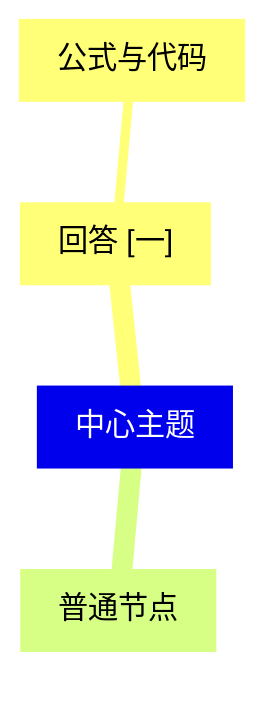

# 可移植研究

<!-- mindmap-ai:outline:start -->
- 中心主题 <!-- mindmap-ai:node {"uid":"root","text":"%E4%B8%AD%E5%BF%83%E4%B8%BB%E9%A2%98"} -->
  - [回答 \[一\]](../../answers/answer-1.md) <!-- mindmap-ai:node {"uid":"answer-node","text":"%E5%9B%9E%E7%AD%94%20%5B%E4%B8%80%5D","answerId":"answer-1"} -->
    - 公式与代码 <!-- mindmap-ai:node {"uid":"detail","text":"%E5%85%AC%E5%BC%8F%E4%B8%8E%E4%BB%A3%E7%A0%81"} -->
  - 普通节点 <!-- mindmap-ai:node {"uid":"plain","text":"%E6%99%AE%E9%80%9A%E8%8A%82%E7%82%B9"} -->
<!-- mindmap-ai:outline:end -->

## Mermaid

